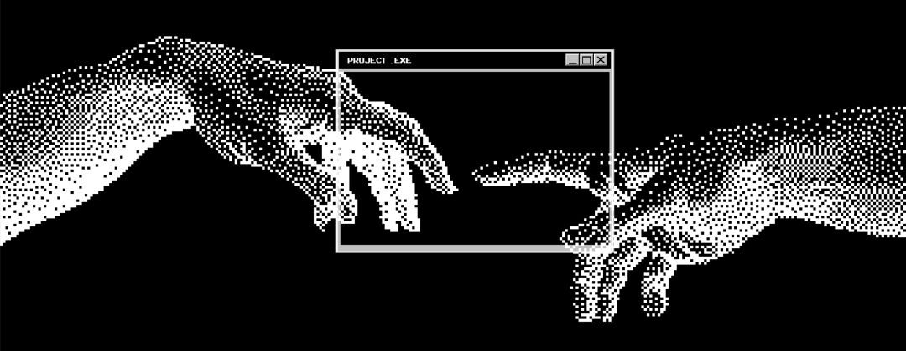
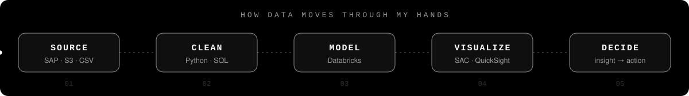

<!-- ============================================================
     GitHub profile README — Navtej Choudhary
     Stats, activity graph and snake are redrawn daily by .github/workflows/profile.yml
     ============================================================ -->

<p align="center">
  
</p>

<p align="center">
  
</p>

<p align="center">
  <a href="https://git.io/typing-svg">
    
  </a>
</p>

<p align="center">
  <a href="mailto:choudharynavtej@gmail.com"></a>
  <a href="https://github.com/navtejchoudhary"></a>
  
</p>

---

### `> cat about_me.py`

<table><tr>
<td width="68%" valign="top">

```python
class Navtej:
    role        = "Data Analyst — SAP & AI"
    based_in    = "Bengaluru, India 🇮🇳"
    degree      = "B.Tech, Computer Science & Engineering"

    def daily_loop(self):
        while data.is_messy():
            clean(); model(); visualize()
        return "a decision someone can act on"

    currently   = [
        "📊 building planning models on SAP Analytics Cloud",
        "🤖 testing AI-assisted analysis in AWS QuickSight",
        "🧱 wrangling pipelines on Databricks",
        "🌐 shipping my portfolio site (GitHub → Vercel)",
    ]
    fun_fact    = "I read dashboards the way some people read novels."
```

</td>
<td width="32%" valign="middle" align="center">
  
</td>
</tr></table>

### `> ./how_i_work.sh`

<p align="center">
  
</p>

### `> ls ./tech_stack`

<p align="center">
  
</p>

<p align="center">
  
  
  
  
  
  
  
  
  
</p>

### `> SELECT * FROM github_stats;`

<p align="center">
  
  
</p>

<p align="center">
  
</p>

### `> plot(activity, kind="line")`

<p align="center">
  
</p>

### `> snake.eat(contributions)`

<p align="center">
  <picture>
    <source media="(prefers-color-scheme: dark)" srcset="https://raw.githubusercontent.com/navtejchoudhary/navtejchoudhary/output/github-snake-dark.svg" />
    <source media="(prefers-color-scheme: light)" srcset="https://raw.githubusercontent.com/navtejchoudhary/navtejchoudhary/output/github-snake.svg" />
    
  </picture>
</p>

<p align="center"><sub><code>// exit 0 — thanks for scrolling.</code></sub></p>
